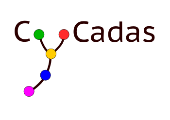
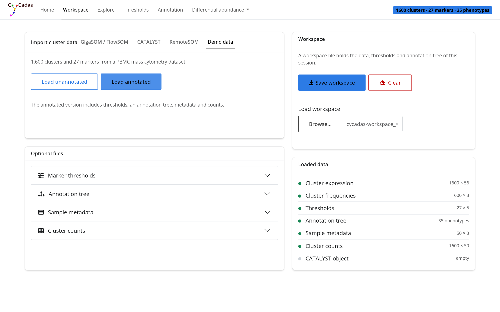
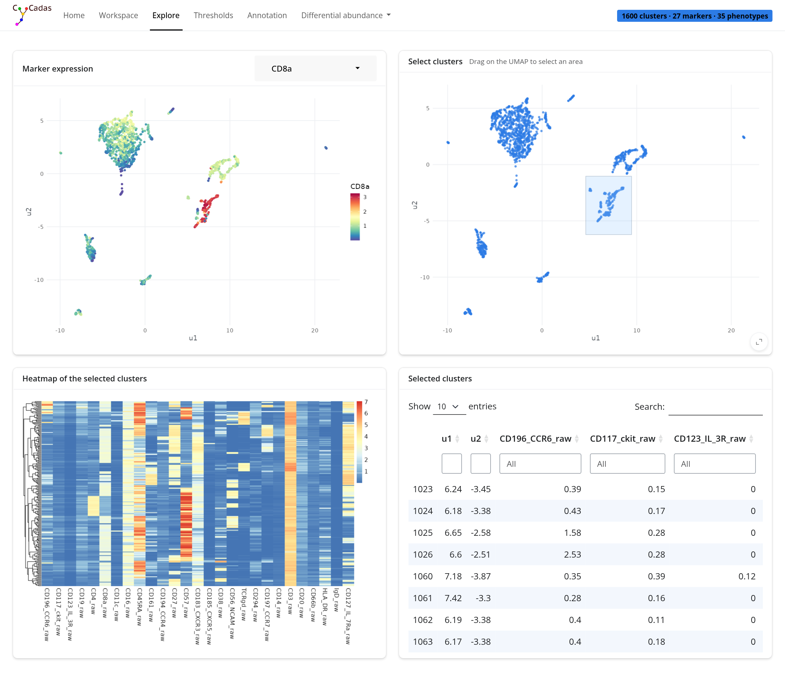
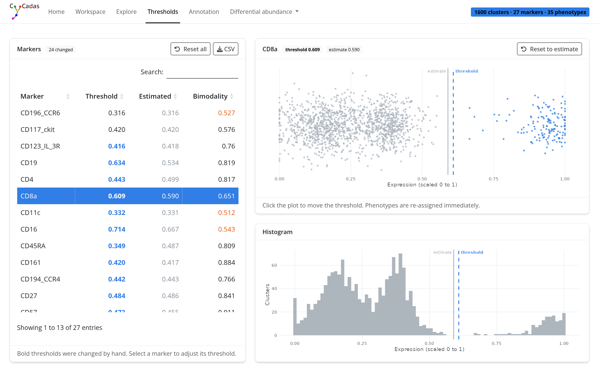
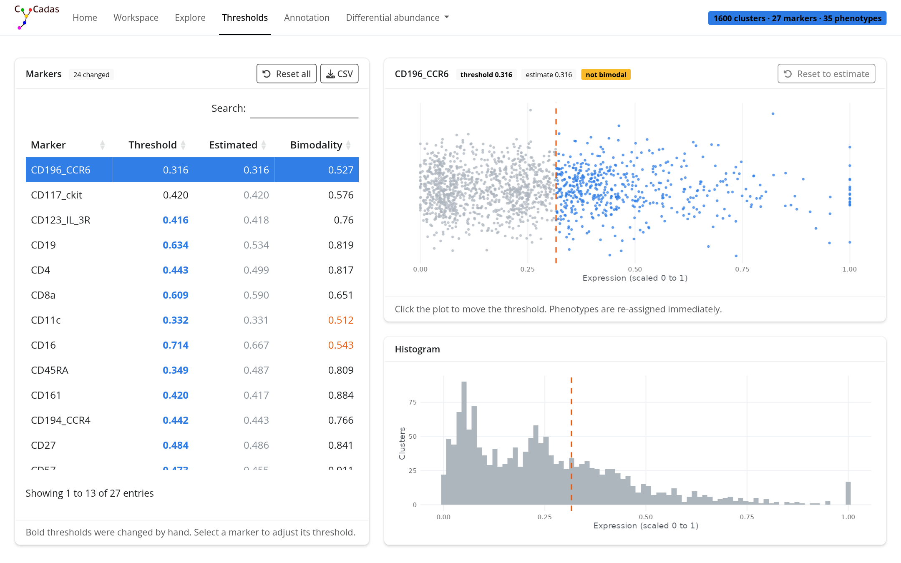
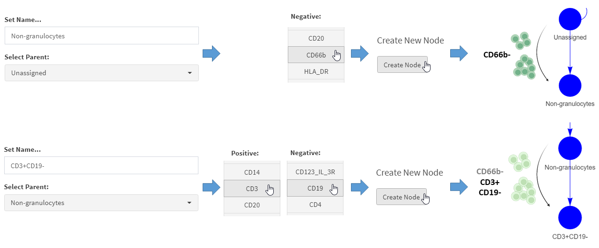
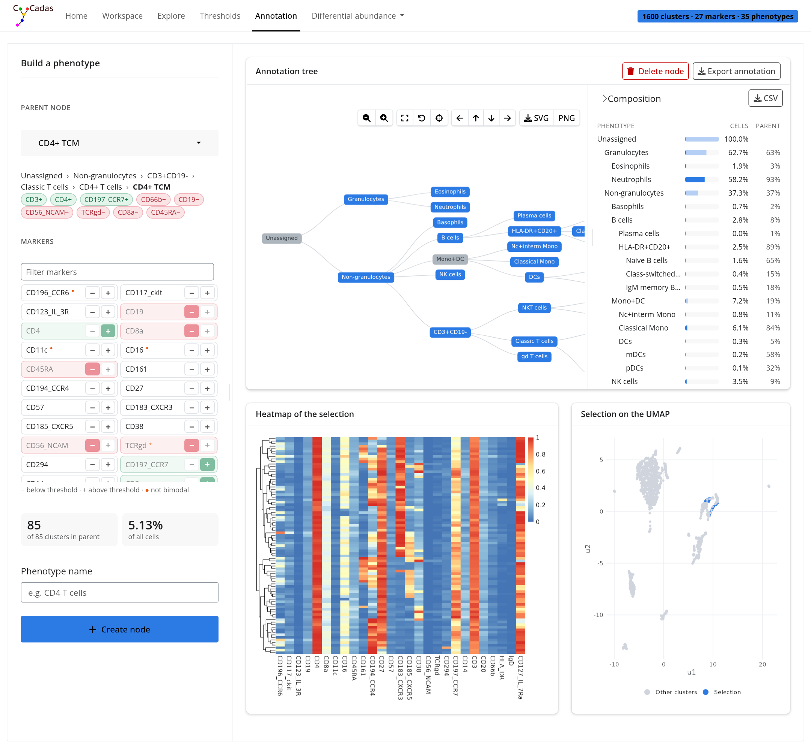
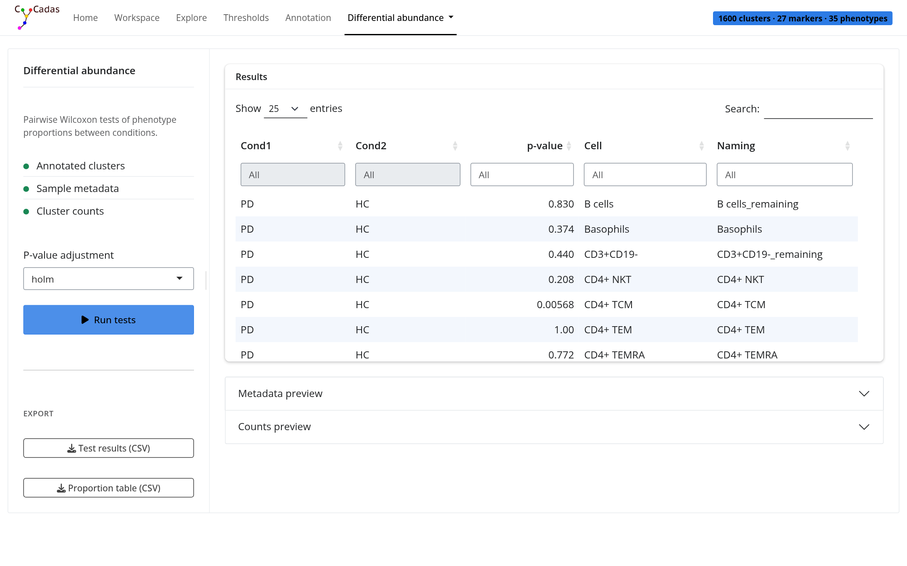
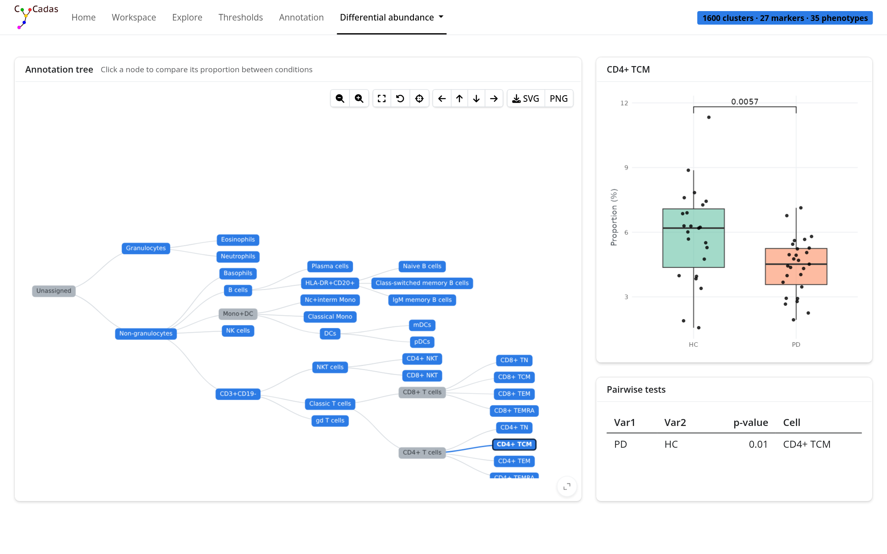

## Cytometry Cluster Annotation and Differential Abundance Suite

#### Efficient and reproducible annotation of cytometry data

[](https://doi.org/10.1093/bioinformatics/btae595)

CyCadas is a Shiny app for annotating the clusters of a cytometry clustering (FlowSOM, GigaSOM, CATALYST, RemoteSOM) and testing the abundance of the annotated cell types between conditions.

Key features:

- estimation of the positive/negative threshold of each marker, with manual adjustment
- interactive inspection of cluster phenotypes on a UMAP and in heatmaps
- annotation as a hierarchical tree of phenotypes defined by marker thresholds
- automatic merging of the clusters of each phenotype
- differential abundance testing between conditions

The current version is 1.5.0. Changes are listed in [NEWS.md](./NEWS.md). Version 1.4.0, with the previous interface, is kept on the [`legacy`](https://github.com/DII-LIH-Luxembourg/cycadas/tree/legacy) branch.

## Installation

``` r
install.packages("devtools")

# Install CyCadas and all required packages
devtools::install_github("DII-LIH-Luxembourg/cycadas", dependencies = TRUE)

library(cycadas)
# start the CyCadas Shiny app
cycadas()
```

To run a local checkout, for example a development branch, start R in the repository folder:

``` r
devtools::install_deps(dependencies = TRUE)
devtools::load_all()
cycadas()
```

On Debian or Ubuntu, `devtools` and its dependencies need these system libraries:

``` bash
sudo apt install build-essential pkg-config libcurl4-openssl-dev libssl-dev libxml2-dev \
  libfontconfig1-dev libharfbuzz-dev libfribidi-dev libfreetype6-dev \
  libpng-dev libtiff5-dev libjpeg-dev libwebp-dev libgit2-dev
```

### Loading SingleCellExperiment data (CATALYST)

Only needed for data clustered with CATALYST or other tools that produce a `SingleCellExperiment`:

``` r
if (!require("BiocManager", quietly = TRUE))
    install.packages("BiocManager")

BiocManager::install("CATALYST")
BiocManager::install("SingleCellExperiment")
```

## Run with Docker

The Docker image includes R and all dependencies.

Prerequisite: [Docker Desktop](https://www.docker.com/products/docker-desktop) installed and running.

1. Pull the image:

   ``` bash
   docker pull ghcr.io/dii-lih-luxembourg/cycadas:latest
   ```

2. Run the application:

   ``` bash
   docker run --rm -p 3838:3838 ghcr.io/dii-lih-luxembourg/cycadas:latest
   ```

3. Open <http://localhost:3838> in a browser. If the terminal shows `0.0.0.0`, use `localhost` in the browser.

Press `Ctrl + C` in the terminal to stop the application.

`latest` is the most recent release. Each release is also available under its version number, for example `ghcr.io/dii-lih-luxembourg/cycadas:1.5.0`. The image is built by the GitHub Actions workflow `.github/workflows/docker.yml` when a version tag is pushed.

To build the image from a local checkout:

``` bash
docker build -t cycadas .
docker run --rm -p 3838:3838 cycadas
```

## Folder sessions

`cycadas(dir)` opens the cluster data in a folder and adds a **Save** button to the navigation bar.

| File | Role |
|------------------------------------|------------------------------------|
| `median_expr.csv` | input: one row per cluster, one column per marker |
| `cluster_freq.csv` | input: column `clustering_prop`, one row per cluster |
| `cluster_counts.csv` | optional input: one row per cluster, one column per sample |
| `metadata.csv` | optional input: `sample_id`, `condition`, ...; read only together with the counts |
| `workspace.rds` | written by **Save**; if present, CyCadas opens it and ignores the input files |
| `labels.csv` | written by **Save**: cluster, label, and path of the label in the tree |

``` r
cycadas("path/to/folder")
```

## Using the app

The navigation bar holds the tabs **Home**, **Workspace**, **Explore**, **Thresholds**, **Annotation** and **Differential abundance**. The badge on the right shows the number of clusters, markers and phenotypes in the session.

### Demo dataset

**Workspace** → **Demo data** loads 1,600 clusters and 27 markers. **Load unannotated** loads the cluster expression only, to build an annotation from scratch. **Load annotated** also loads thresholds, an annotation tree with 35 phenotypes, sample metadata and cluster counts.

*The demo dataset was generated from publicly available mass cytometry data of patients with idiopathic Parkinson's disease and healthy controls (Capelle, C.M. et al., Nat Commun, 2023), clustered with GigaSOM into 1,600 clusters.*

### Workspace



**Import cluster data** reads one of:

- **GigaSOM / FlowSOM**: a median marker expression table (cluster × marker) and a cluster frequency table, both CSV
- **CATALYST**: a `SingleCellExperiment` saved as `.rds`
- **RemoteSOM**: the JSON output of RemoteSOM

**Optional files** adds marker thresholds, an annotation tree (nodes and edges CSV), sample metadata and cluster counts. Differential abundance testing requires metadata and counts.

**Save workspace** writes the data, thresholds, annotation tree, metadata, counts and UMAP coordinates to one `.rds` file. **Load workspace** restores a saved session. **Clear** empties the session. **Loaded data** lists each table and its dimensions.

### Explore



The left UMAP shows each cluster coloured by the expression of the selected marker. Drag a rectangle on the right UMAP to select clusters. The heatmap and the table below show the marker expression of the selected clusters.

### Thresholds

The marker table lists, for each marker, the threshold in use, the estimated threshold and the bimodality coefficient. The estimate is the midpoint of a two-group 1-D k-means split or of a two-component Gaussian mixture (Mclust), whichever gives the higher mean silhouette. A bimodality coefficient below 0.555 is shown in orange.

Select a marker to plot its cluster expression. Click the scatter plot to move the threshold; the clusters are re-assigned to phenotypes at once. Thresholds changed by hand are shown in bold, and the estimate stays visible as a grey line. **Reset to estimate** restores one marker, **Reset all** restores every marker. **CSV** exports the table.

*CD8a, bimodal, threshold moved from the estimate of 0.590 to 0.609:*



*CD196_CCR6, bimodality coefficient 0.527, labelled "not bimodal":*



### Annotation

Annotation builds a tree of phenotypes. All clusters start in the root node "Unassigned". A new node takes from its parent the clusters that match a set of positive and negative markers. Further nodes split it into subtypes, to the level of detail the user chooses.

*Building the annotation tree:*





To create a node:

1. Choose the **Parent node** in the sidebar, or click a node in the tree. The markers fixed by its ancestors are shown under the node name.
2. Set markers to **+** (above threshold) or **−** (below threshold). Markers marked with an orange dot are not bimodal.
3. Check the matching clusters: the counter gives their number and their share of all cells, and the heatmap and UMAP below the tree show them.
4. Enter a **Phenotype name** and click **Create node**.

The **Composition** panel lists each phenotype's share of all cells and of its parent node; **CSV** exports it. The tree toolbar zooms, fits, pans, and saves the tree as SVG or PNG. **Export annotation** downloads a zip with the expression table and the tree as CSV files; the nodes and edges files can be loaded again under **Workspace** → **Optional files** → **Annotation tree**. **Delete node** removes the selected node if it has no children and returns its clusters to the parent.

For CATALYST data, the sidebar also selects the meta-cluster level. **Merge annotation** adds the annotation to the `SingleCellExperiment` and **Export object** downloads it.

### Differential abundance

**Results table** runs pairwise Wilcoxon tests of the proportion of each phenotype between the conditions in the metadata. The sidebar sets the p-value adjustment (holm, hochberg, hommel, bonferroni, BH, BY, fdr or none) and exports the test results and the proportion table (percentage of each phenotype in each sample) as CSV.



**Interactive tree** plots the proportion of a phenotype per condition when its node is clicked, with the pairwise tests below.



## Preparing input data

### Single Cell Format (CATALYST)

``` r

# CATALYST Workflow using Single Cell Experiment data object
# Preprocessing ...

# Cluster with CATALYST
sce <- cluster(sce, features = "type", 
               xdim = 10, ydim = 10, maxK = 20, 
               verbose = FALSE, seed = 1)   

# Save the object as .rds file
saveRDS(sce, "my_sce.rds")

# Load into CyCadas
# Annotate the desired (meta-)cluster levels
# use the integrated merge function within Cycadas
# save the object 
# load it back into your workflow
sce <- readRDS("Annotated_sce.rds")

# continue downstream analysis
# ...
```

### Data Input from FlowSOM

#### Median Expression and Cluster Frequencies:

``` r
# within your clustering workflow create sample_ids according to the metadata files:

sample_ids <- rep(metadata$sample_id, fsApply(fcs, nrow))

library(FlowSOM)
fsom <- ReadInput(fcs, transform = FALSE, scale = FALSE)

set.seed(42)
som <- BuildSOM(fsom, colsToUse = lineage_markers, xdim=20, ydim=20, rlen=40)

expr_median <- som$map$medianValues

# Calculate cluster frequencies
clustering_table <- as.numeric(table(som$map$mapping[,1]))
clustering_prop <- round(clustering_table / sum(clustering_table) * 100, 2)
df_prop <- as.data.frame(clustering_prop)
df_prop$cluster <- rownames(df_prop)

write.csv(expr_median, "expr_median.csv", row.names = F)
write.csv(df_prop, "cluster_freq.csv")

## ----------------------------------------------------------------------------
## Generate the Proportion Table
## ----------------------------------------------------------------------------
counts_table <- table(som$map$mapping[,1], sample_ids)
props_table <- t(t(counts_table) / colSums(counts_table)) * 100

props <- as.data.frame.matrix(props_table)

write.csv(props, "proportion_table.csv")
```

### Data Input from [GigaSOM.jl](https://github.com/LCSB-BioCore/GigaSOM.jl)

#### Median Expression and Cluster Frequencies:

``` julia
gridSize = 20
nEpochs = 40

# Assume the dataset is loaded in distributed data info `di`, e.g. using `loadFCSSet`.
som = initGigaSOM(di, gridSize, gridSize, seed = 42) # set a seed value here
som = trainGigaSOM(som, di, epochs = nEpochs)
mapping_di = mapToGigaSOM(som, di)

num_cluster = gridSize^2

# Get the Cluster Frequencies for CyCadas:
clusterFreq = dcount(num_cluster, mapping_di)
df = DataFrame(cluster = 1:length(df), clustering_prop = clusterFreq)
df.clustering_prop = df.clustering_prop ./ sum(df.clustering_prop)
CSV.write("cluster_freq.csv", df)

# Get the count table per fileID (optional - Count Table in CyCadas).
# Assume `md` is a data frame that describes the data
# (i.e., it contains a row for all filenames loaded in `di` in the same order,
# together with sample identifiers)
files = distributeFCSFileVector(:fileIDs, md[:, :file_name])
count_tbl = dcount_buckets(num_cluster, mapping_di, size(md, 1), files)
ct = DataFrame(count_tbl, :auto)
rename!(ct, md.sample_id)
CSV.write("cluster_counts.csv", ct)

# Get the median Marker Expressions.
# Assume lineage_markers is a human-readable list of markers used in clustering
# (here used for annotating the median expression table)
expr_tbl = dmedian_buckets(di, num_cluster, mapping_di, cols)
et  = DataFrame(expr_tbl, :auto)
rename!(et, lineage_markers)
CSV.write("median_expr.csv", et)
```

