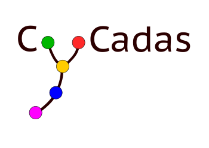
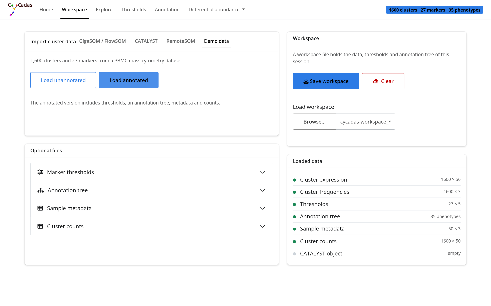
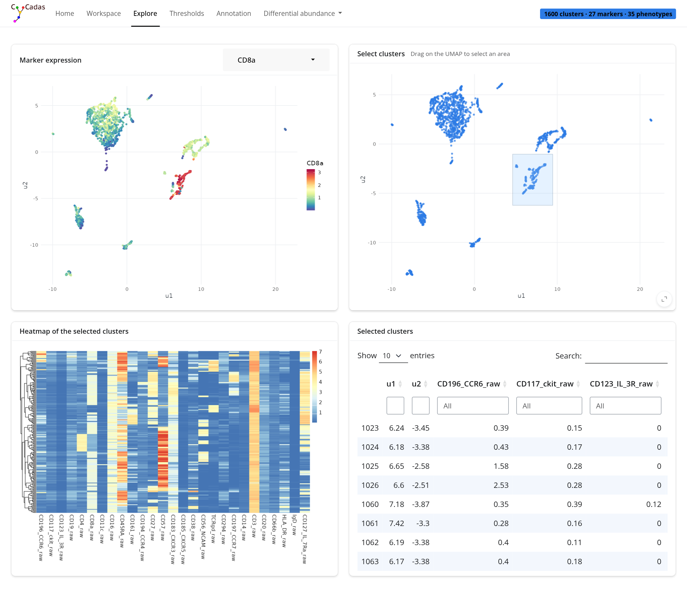
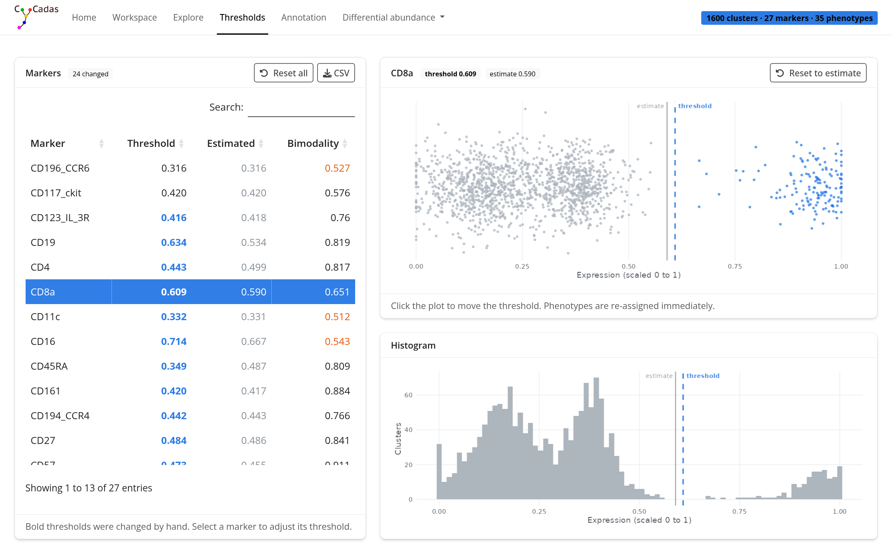
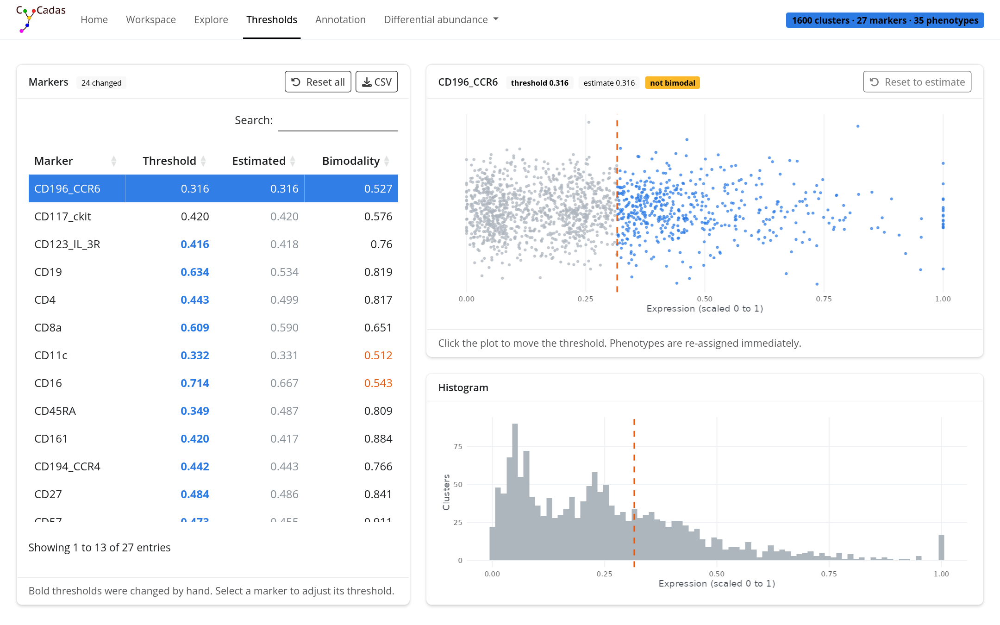
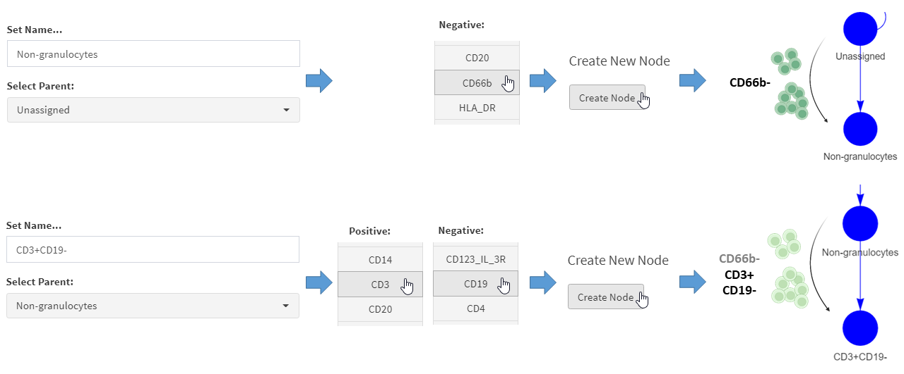
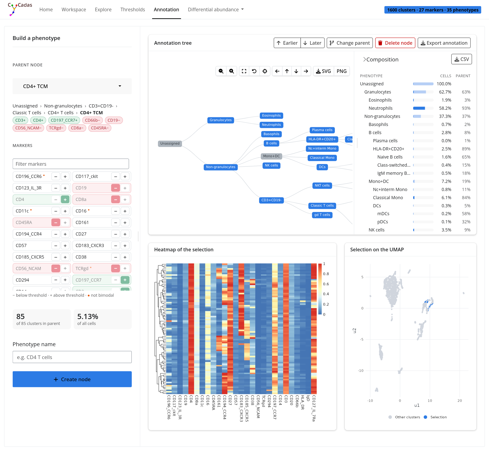
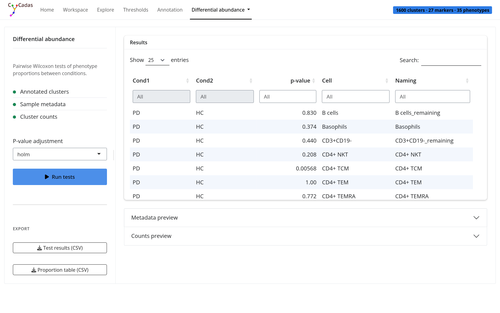
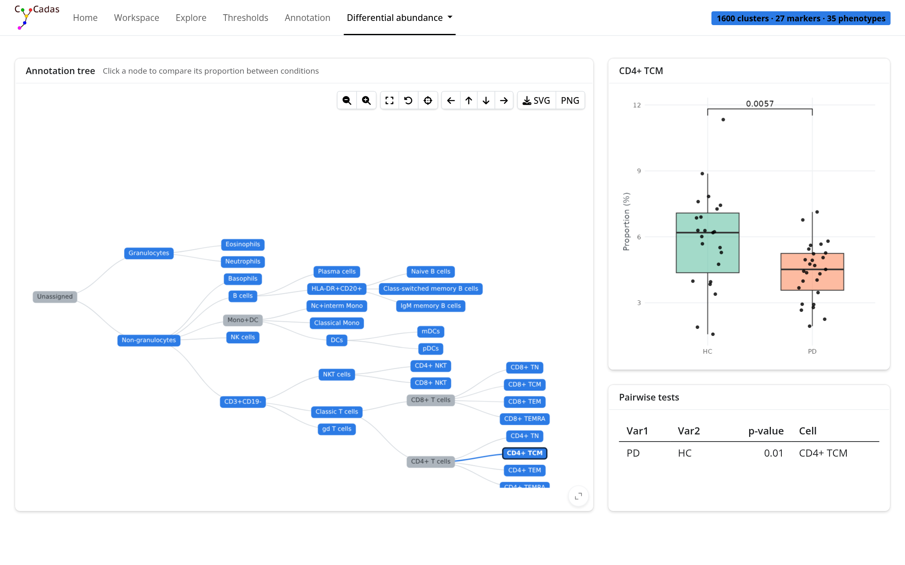

## **Cy**tometry **C**luster **A**nnotation and **D**ifferential **A**bundance **S**uite

#### Efficient and reproducible annotation of cytometry data

CyCadas annotates the clusters of a cytometry clustering (FlowSOM, GigaSOM, CATALYST, RemoteSOM) and tests the abundance of the annotated cell types between conditions.

Code examples for exporting the input tables from GigaSOM, FlowSOM and CATALYST workflows are in the [README on GitHub](https://github.com/DII-LIH-Luxembourg/cycadas#preparing-input-data).

## Using the app

The navigation bar holds the tabs **Home**, **Workspace**, **Explore**, **Thresholds**, **Annotation** and **Differential abundance**. The badge on the right shows the number of clusters, markers and phenotypes in the session.

### Demo dataset

**Workspace** → **Demo data** loads 1,600 clusters and 27 markers. **Load unannotated** loads the cluster expression only, to build an annotation from scratch. **Load annotated** also loads thresholds, an annotation tree with 35 phenotypes, sample metadata and cluster counts.

*The demo dataset was generated from publicly available mass cytometry data of patients with idiopathic Parkinson's disease and healthy controls (Capelle, C.M. et al., Nat Commun, 2023), clustered with GigaSOM into 1,600 clusters.*

### Workspace

**Import cluster data** reads one of:

- **GigaSOM / FlowSOM**: a median marker expression table (cluster × marker) and a cluster frequency table, both CSV
- **CATALYST**: a `SingleCellExperiment` saved as `.rds`
- **RemoteSOM**: the JSON output of RemoteSOM

**Optional files** adds marker thresholds, an annotation tree (nodes and edges CSV), sample metadata and cluster counts. Differential abundance testing requires metadata and counts.

**Save workspace** writes the data, thresholds, annotation tree, metadata, counts and UMAP coordinates to one `.rds` file. **Load workspace** restores a saved session. **Clear** empties the session. **Loaded data** lists each table and its dimensions.

### Explore

The left UMAP shows each cluster coloured by the expression of the selected marker. Drag a rectangle on the right UMAP to select clusters. The heatmap and the table below show the marker expression of the selected clusters.

### Thresholds

The marker table lists, for each marker, the threshold in use, the estimated threshold and the bimodality coefficient. The estimate is the midpoint of a two-group 1-D k-means split or of a two-component Gaussian mixture (Mclust), whichever gives the higher mean silhouette. A bimodality coefficient below 0.555 is shown in orange.

Select a marker to plot its cluster expression. Click the scatter plot to move the threshold; the clusters are re-assigned to phenotypes at once. Thresholds changed by hand are shown in bold, and the estimate stays visible as a grey line. **Reset to estimate** restores one marker, **Reset all** restores every marker. **CSV** exports the table.

*CD8a, bimodal, threshold moved from the estimate of 0.590 to 0.609:*

*CD196_CCR6, bimodality coefficient 0.527, labelled "not bimodal":*

### Annotation

Annotation builds a tree of phenotypes. All clusters start in the root node "Unassigned". A new node takes from its parent the clusters that match a set of positive and negative markers. Further nodes split it into subtypes, to the level of detail the user chooses.

*Building the annotation tree:*

To create a node:

1. Choose the **Parent node** in the sidebar, or click a node in the tree. The markers fixed by its ancestors are shown under the node name.
2. Set markers to **+** (above threshold) or **−** (below threshold). Markers marked with an orange dot are not bimodal.
3. Check the matching clusters: the counter gives their number and their share of all cells, and the heatmap and UMAP below the tree show them.
4. Enter a **Phenotype name** and click **Create node**.

The **Composition** panel lists each phenotype's share of all cells and of its parent node; **CSV** exports it. The tree toolbar zooms, fits, pans, and saves the tree as SVG or PNG. **Export annotation** downloads a zip with the expression table and the tree as CSV files; the nodes and edges files can be loaded again under **Workspace** → **Optional files** → **Annotation tree**. **Delete node** removes the selected node if it has no children and returns its clusters to the parent.

### Annotation order

The order of the tree decides which phenotype a cluster gets. Nodes are applied from the root down, and when a cluster matches several siblings, the earlier sibling takes it. **Earlier** and **Later** move the selected node among its siblings. **Change parent** moves the selected node and its subpopulations below another node; each node keeps its own markers, so its lineage changes. After each change all clusters are re-assigned, and a message gives the number of clusters that changed phenotype. If the new lineage requires a marker to be both positive and negative, a warning names the marker; such a node can no longer match any cluster.

For CATALYST data, the sidebar also selects the meta-cluster level. **Merge annotation** adds the annotation to the `SingleCellExperiment` and **Export object** downloads it.

### Differential abundance

**Results table** runs pairwise Wilcoxon tests of the proportion of each phenotype between the conditions in the metadata. The sidebar sets the p-value adjustment (holm, hochberg, hommel, bonferroni, BH, BY, fdr or none) and exports the test results and the proportion table (percentage of each phenotype in each sample) as CSV.

**Interactive tree** plots the proportion of a phenotype per condition when its node is clicked, with the pairwise tests below.

